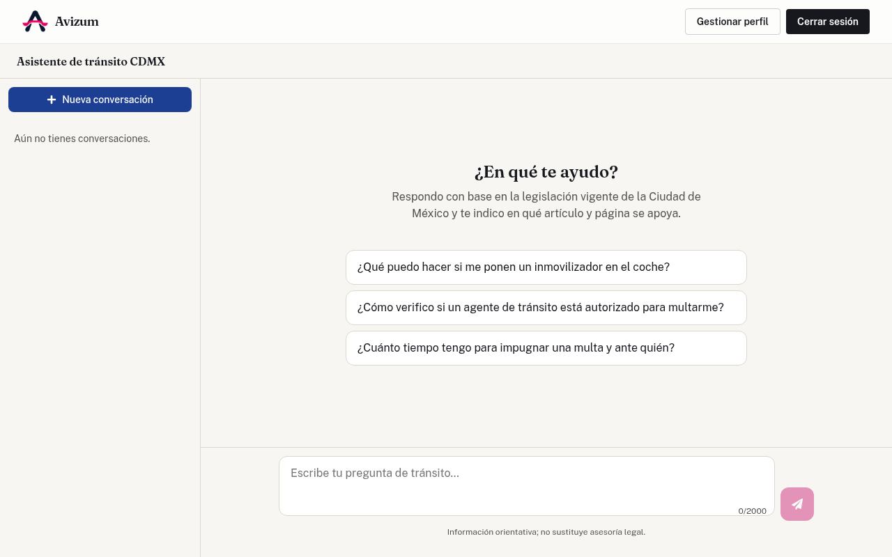
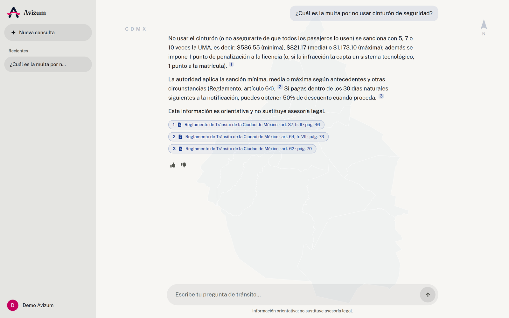
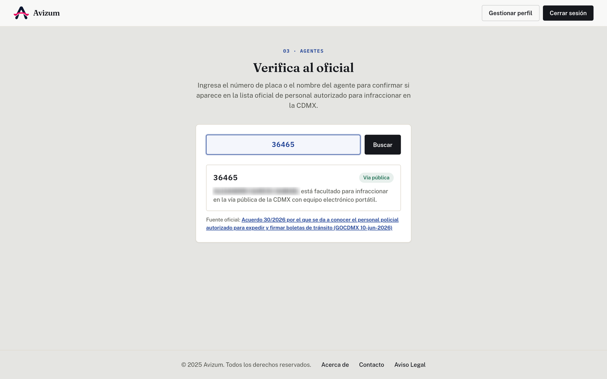
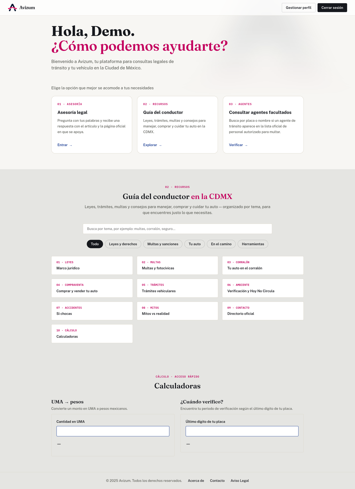
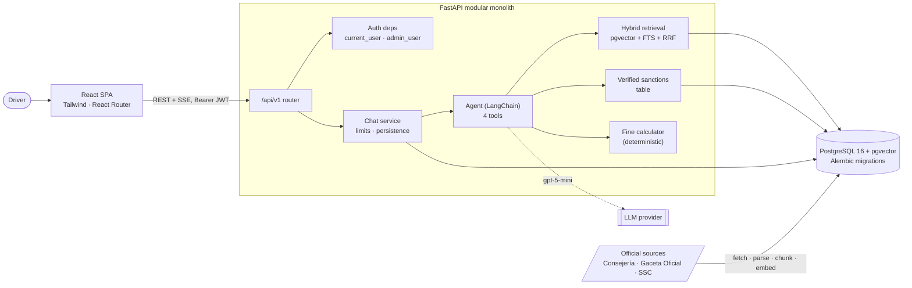

<div align="center">

# Avizum

**Know your rights on the road.**
A traffic-law assistant for Mexico City drivers: verify that an officer is authorized to fine you, understand your infraction, and learn the regulation, all grounded in official sources.


</div>

---

## Why this exists

In Mexico City, a traffic stop is an asymmetric situation: most drivers don't know which officers are legally authorized to issue fines, which article applies, how much a fine really is, or how to contest it. The information is public, but it is scattered across PDFs, the official gazette and government portals.

Avizum puts it in one place, in plain Spanish, and never invents an answer. If the system can't ground a response in an official document, it says so instead of guessing.

## What it does

| Feature | Description |
|---|---|
| **Legal assistant** | Chat agent over 13 official sources (3,299 indexed passages). Every claim carries a citation that opens the official PDF at the right page. Streams its answer and shows which sources it is consulting. |
| **Officer verification** | Look up a badge number or name against the registry of officers authorized to issue fines (Acuerdo 30/2026: 717 street-patrol and 570 camera-system entries, counts validated against the decree). |
| **Driver's guide** | Ten searchable categories (fines, impound, vehicle procedures, emissions and *Hoy No Circula*, accidents, myths vs. reality), each article citing its source and last update. |
| **Calculators** | UMA → pesos for fines, and a verification-period finder by license plate. |
| **Accounts and roles** | Email + password auth, profile management, role-based admin API with usage statistics. |

## Screenshots

<table>
  <tr>
    <td width="50%"></td>
    <td width="50%"></td>
  </tr>
  <tr>
    <td align="center"><sub>Assistant: empty state</sub></td>
    <td align="center"><sub>Answer with numbered citations that open the official PDF</sub></td>
  </tr>
  <tr>
    <td width="50%"></td>
    <td width="50%"></td>
  </tr>
  <tr>
    <td align="center"><sub>Officer verification against the registry</sub></td>
    <td align="center"><sub>Home and searchable driver's guide</sub></td>
  </tr>
</table>

## Architecture



**Key design decisions**

- **Modular monolith, not microservices.** One FastAPI app, one PostgreSQL database (relational data, vectors and full-text search together), one deployable. Route handlers stay thin; reusable logic lives in `app/services/`.
- **Identity comes from the token, never the request.** Ownership checks always compare against the JWT subject, and foreign resources answer 404. There is no self-service admin signup.
- **Passwords use Argon2** (`pwdlib`). JWT is a Bearer token.
- **Alembic is the schema source of truth.** The 244 backend tests run against real PostgreSQL, not SQLite, so Postgres-only behavior (native enums, generated `tsvector` columns, pgvector) is actually exercised.
- **A user's message is stored before the answer is generated**, so it survives a failed or cancelled generation; partial answers are saved as `cancelled`.
- **Official sources are versioned.** Each is downloaded over verified TLS and stored with its SHA-256, reform date and retrieval date, so an answer traces to an exact document version. The legacy pickle-based FAISS index was removed rather than trusted.

## The legal assistant

Legal answers have a failure mode that ordinary chatbots don't tolerate: a confident, wrong article number or amount. The design treats that as the central problem.

### Retrieval built around how laws are written

- Chunks follow the legal structure: one per **article**, split by **fraction** when long, with the heading path (`Reglamento › Título III › Art. 30, fr. II`) prepended before embedding. Articles with heavy introductions are split so the part with the sanction is not diluted.
- **Hybrid search in plain PostgreSQL:** pgvector cosine similarity plus Spanish full-text search (`unaccent`), merged with Reciprocal Rank Fusion. Vectors handle paraphrase ("me pasé el alto"); full-text handles exact references ("art. 30 fr. II"), where embeddings are weak.
- **Query rewriting into legal vocabulary**, fused with the user's original wording. Measured across two independent sets, it was the one change that helped consistently (+0.08 to +0.24 recall@5 over raw search), so it stayed. An LLM reranker and splitting by sub-items (a, b, c) were also measured and **discarded**: the first was within noise, the second lowered recall from 0.80 to 0.60.
- On a 60-question held-out set written after the pipeline was tuned, recall@5 was 0.85 (0.84 on the tuning set), so it generalizes rather than overfits.

### An agent with tools, not a prompt with a PDF

`buscar_legislacion`, `obtener_articulo` (to follow cross-references), `buscar_agente` and `calcular_multa`, built on LangChain's `create_agent` with `gpt-5-mini`. Guardrails live in code, not only in the prompt: a cap on model calls and tool calls per turn, a middleware that strips the tools on the last allowed call so the user always gets an answer, a limit of three searches per turn, and rejection of near-duplicate queries. Fine arithmetic is delegated to code; the model is not allowed to compute amounts.

### Sanctions as verified structured data

The first evaluation found the kind of error that matters most: for the seat belt, the model quoted "10, 15 or 20 UMA" instead of "5, 7 or 10", because two fractions of the same article reuse the same sub-item letters with different amounts. Prose retrieval cannot reliably tell them apart, so the fix was in the data, not the prompt:

- A **deterministic extractor** (no model involved) turns each article of the Reglamento de Tránsito into rows of *conduct → sanction* (UMA range, license points, plate retention, other consequences).
- **A person verified the rows** against the official text (230 verified). Each row stores a hash of the text it came from; if a reform changes the article, the row becomes `stale` and stops being served until it is re-reviewed. The agent falls back to the prose, and fails closed.
- The rows travel **in the same tool call** as the retrieved passage, so there is no extra round trip.
- **Every amount in the final answer is checked** against what the tools actually served in that turn; an amount that appears in no source is flagged.

### Refusal is a feature

- Every legal claim carries a `[n]` marker mapped to a real retrieved passage; markers that match nothing are stripped and logged as anomalies.
- Below a calibrated similarity threshold the tool returns "no relevant results" and the agent declines instead of improvising.
- Out-of-scope questions, other states (including Estado de México) and attempts to override the instructions get a short, polite refusal.
- The agent never says a person is "fake": it reports whether they appear in the current official list and what to do if not.

### Data integrity, not just data

The authorized-officer registry comes from a single source, SSC *Acuerdo 30/2026* in the Gaceta Oficial. The import validates counts against the totals the decree declares and fails if they don't match; the previous CSV was silently missing records, which is exactly what this check prevents. Press reports are explicitly not accepted as a source.

### Measured

A 74-case agent evaluation (two runs per case, since the model is not deterministic) covers driving, parking, accidents, fines, camera-issued tickets, **11 false-premise questions**, questions with no basis in the corpus, and refusals. A separate 26-case suite checks sanction amounts against the human-verified rows rather than against the retriever or the model. Reviews were done by reading each answer against the official text, not by an automatic judge. Full write-up: [`docs/evaluation/report.md`](docs/evaluation/report.md).

| | Result |
|---|---|
| False premises accepted | 0 of 11, in both runs |
| Sanction amount exact (3 runs × 25 cases) | 69 of 70; 0 amounts taken from a different conduct |
| Execution errors | 0 |
| Latency per turn (mean / p95) | 6.6 s / 10.6 s |
| Cost per answer | about USD 0.003 |

Comparing models, `gpt-5-nano` cited worse (35 answers that used tools and cited nothing) and was not faster, so `gpt-5-mini` is the production model. The comparison also surfaced a concurrency bug (parallel tool calls sharing one SQLAlchemy session), fixed with a per-turn lock.

### Cost and abuse controls

40 messages per user per day, 2,000-character limit, 200 messages per conversation, 12-message context window, 1,800 output tokens, at most 6 model calls and 12 tool calls per turn. One in-flight answer per conversation (409 otherwise).

## Engineering practices

- **Spec → plan → implementation.** Features start as a written design and a task-by-task plan (see [`docs/superpowers/`](docs/superpowers/)).
- **Tests against real PostgreSQL**, with per-test schema creation. Extractor tests use real text from the official PDFs as fixtures.
- **Bugs found and root-caused in the open.** The email-only auth [spec](docs/superpowers/specs/2026-09-06-email-only-auth-design.md) documents why registration could never succeed and removes the field entirely; the evaluation report lists what each run found and how it was resolved.
- **Security by default:** Argon2, no client-supplied identity, no self-service admin, ownership checks that answer 404, and errors that never expose provider details.

## Tech stack

| Layer | Technology |
|---|---|
| Frontend | React 19, React Router 7, Tailwind CSS, Axios, `react-markdown` |
| Backend | Python 3.11+, FastAPI, SQLAlchemy 2, Pydantic v2, Alembic, `uv` |
| Database | PostgreSQL 16 (Docker Compose for local development) |
| Auth | JWT (Bearer), Argon2 password hashing |
| Testing | pytest against PostgreSQL (244 tests), React Testing Library |
| AI | LangChain v1 agent (`gpt-5-mini`), pgvector + Spanish full-text hybrid retrieval with RRF, SSE streaming |
| Evaluation | Scripted runs, deterministic checks and per-case review (`backend/scripts/eval_*.py`) |

## Quick start

**Prerequisites:** [uv](https://docs.astral.sh/uv/), Node.js 18+, Docker (for PostgreSQL). On WSL, enable Docker Desktop's WSL integration.

```bash
# 1. Database
docker compose up -d db

# 2. Backend (http://localhost:8000, docs at /docs)
cd backend
cp .env.example .env            # set JWT_SECRET_KEY
uv sync --group dev
uv run alembic upgrade head
uv sync --group dev --group ingest
uv run python -m scripts.fetch_sources       # download and register official sources (data/sources.json)
uv run python -m scripts.import_agents       # import the current authorized-agents acuerdo
uv run python -m scripts.ingest_sources      # parse, chunk and embed into pgvector (needs OPENAI_API_KEY in .env)
uv run python -m scripts.sanctions --help    # extract / review / apply the structured sanctions table
uv run uvicorn app.main:app --reload --host 0.0.0.0

# 3. Frontend (http://localhost:3000), in another terminal
cd frontend
npm install
npm start
```

Create an account in the UI, then promote it to admin if you want the admin panel:

```bash
uv run python -m scripts.promote_admin you@example.com
```

Run the tests (needs the `db` container running, or `TEST_DATABASE_URL`):

```bash
cd backend && uv run pytest
```

Set `REACT_APP_API_URL` in `frontend/.env` if the API isn't at `http://localhost:8000/api/v1`.

## API overview

All routes are under `/api/v1`. Interactive docs are served at `/docs`.

| Method | Route | Auth | Purpose |
|---|---|---|---|
| `GET` | `/health` | public | Health check |
| `POST` | `/auth/register` | public | Create a `user` account |
| `POST` | `/auth/login` | public | Exchange credentials for a JWT |
| `GET` `PATCH` | `/users/me` | user | Read or update own profile |
| `GET` | `/agents/search?q=` | public | Check whether an officer is authorized (by plate or name) |
| `GET` `POST` | `/conversations` | user | List or create the user's conversations |
| `PATCH` `DELETE` | `/conversations/{id}` | owner | Rename (1-80 chars) or delete a conversation |
| `GET` | `/conversations/{id}/messages` | owner | Messages with citations and the viewer's own vote |
| `POST` | `/conversations/{id}/messages` | owner | Ask the assistant: JSON, or Server-Sent Events with `Accept: text/event-stream` (limits: 2,000 chars, 40/day, 200 per conversation) |
| `PUT` `DELETE` | `/messages/{id}/feedback` | owner | 👍 / 👎 on an assistant answer |
| `GET` | `/admin/users` | admin | List users |
| `PATCH` | `/admin/users/{id}` | admin | Change a user's role |
| `GET` | `/admin/statistics` | admin | Usage statistics |

## Repository layout

```text
frontend/            React SPA (components, pages, services, driver's-guide content)
backend/             FastAPI app, Alembic migrations, tests
  app/api/           Routes and auth dependencies
  app/core/          Config and security
  app/models/        SQLAlchemy models
  app/schemas/       Pydantic request/response models
  app/services/      Business logic and integrations
data/
  sources.json       Manifest of official sources (URL, reform date, expected counts)
  legal-sources/     Official legal PDFs (downloaded by scripts.fetch_sources, not committed)
database/schema.sql  Reference schema (Alembic is authoritative)
docs/superpowers/    Design specs and implementation plans
```

`backend/node-api/` and `ai/` are legacy prototypes kept only as reference. They are not run and receive no new features.

## Disclaimer

Avizum provides general orientation based on public legal documents. It does not replace professional legal advice or the intervention of competent authorities.

## Authors

Avizum is a personal project designed and developed by Alexis Vences.
